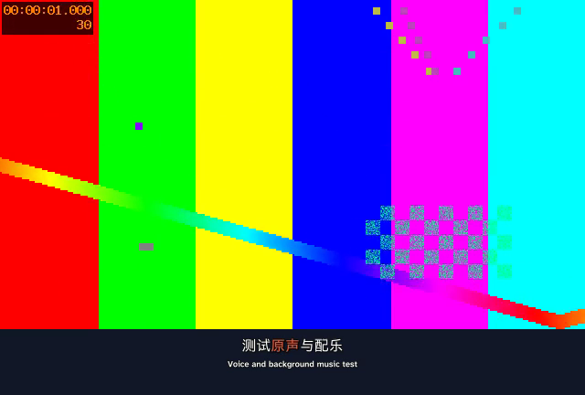
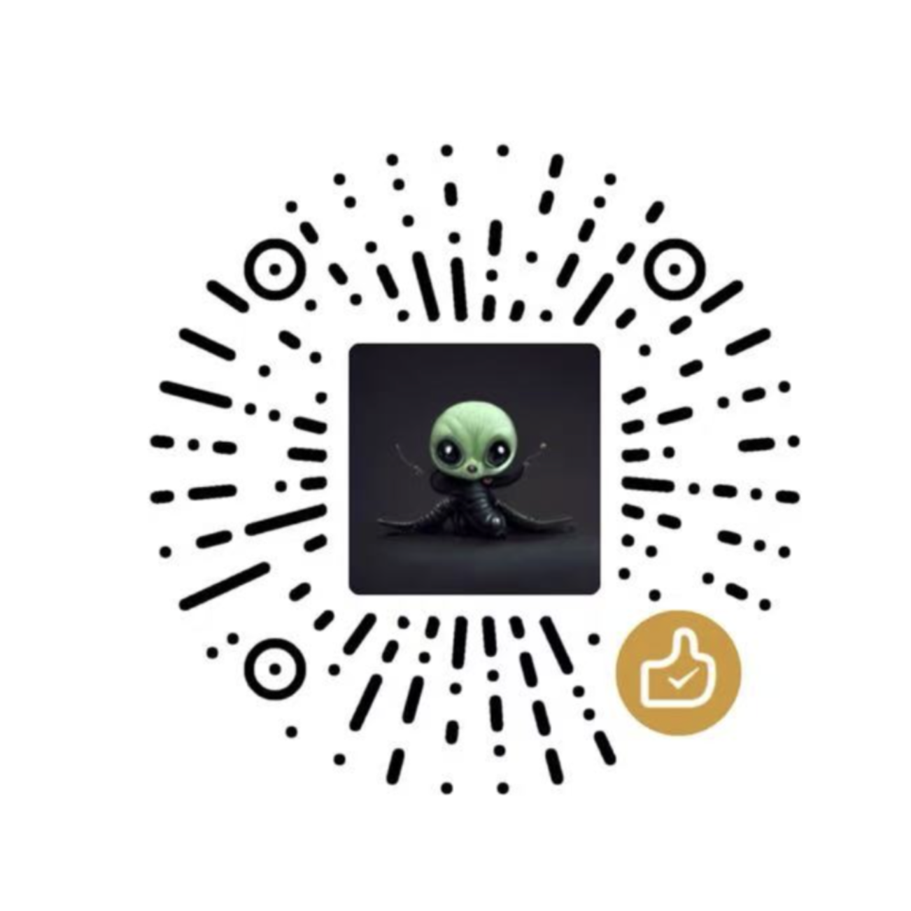

# Qiaomu Screen2Video

录屏已经讲清楚了，补字幕、找音乐、做封面却还要花半天。

把录屏交给 Agent，得到带中英字幕、重点高亮、界面指引、原创配乐和品牌片尾的 MP4，同时保留字幕、素材和可查看的制作页面。

[](https://github.com/joeseesun/qiaomu-screen2video/stargazers)
[](https://github.com/joeseesun/qiaomu-screen2video/forks)
[](https://github.com/joeseesun/qiaomu-screen2video/issues)
[](https://github.com/joeseesun/qiaomu-screen2video/commits/main)
[](LICENSE)

```bash
npx skills add joeseesun/qiaomu-screen2video
```



上图来自本包真实 FFmpeg 测试导出，背景为合成测试画面；演示字幕渲染机制，不代表真实录屏内容或云端识别效果。

**[中文](#中文) | [English](#english)**

<a name="中文"></a>
## 你可以这样说

> “给这段录屏加中英字幕和轻配乐，做一个 B 站风格封面。”
>
> “把这份外置麦克风录音对齐录屏，降噪后用它作为成片讲述。”
>
> “保留原速，关键操作加箭头，导出 MP4 和双语 SRT。”

## 你会得到

- **电影式双语字幕**：中文在上、英文在下，使用随包提供的霞鹜新晰黑和 Atkinson Hyperlegible Next 字体；默认在原画面内叠加。
- **跟着内容走的动效**：逐词重点高亮、关键词花字、表情贴纸、界面箭头和聚光框；章节卡按最终倍速校验可读时长。
- **原创配乐与轻音效**：默认代码作曲；可选 FluidSynth 乐器音色。讲话时自动压低音乐，最终混音检查响度。YuE2 / Suno 仅在明确要求时使用。
- **录屏包装**：默认同步 1.35 倍速；片头原比例、16:9、9:16 封面分别构图；品牌片尾按横竖版重排。
- **可选音频处理**：独立录音对齐、FFmpeg 降噪或已验证版本的本机剪映音频适配，处理后同一音轨贯穿识别与合成。
- **可修改的交付包**：MP4、中文/英文/双语 SRT、ASS、动效计划和 `review.html`；设置改变后重渲染，输入文件保留。

Agent 负责理解讲述、清理字幕、翻译和选择动效；脚本负责校验与 FFmpeg/ASS 合成。制作页面便于查看进展，关闭它不会停止任务。

```text
本次任务/
├── review.html            制作进度、视频和字幕查看页
├── captions.json         清理与翻译后的字幕
├── motion-plan.json      动效时间轴
├── assets/               封面、音乐与片尾
└── output/
    ├── final.mp4
    ├── zh.srt / en.srt / bilingual.srt
    ├── subtitles.ass
    ├── motion-qa.json
    └── render.json       时长、解码与响度检查
```

## 安装

1. 安装 skill，选择你使用的 Agent：

   ```bash
   npx skills add joeseesun/qiaomu-screen2video
   npx skills add joeseesun/qiaomu-screen2video --list
   ```

   第二条应列出 `qiaomu-screen2video`。不加 `-g` 时安装到当前项目。

2. macOS 准备运行环境（已装 Homebrew）：

   ```bash
   brew install uv ffmpeg-full
   uv venv ~/.cache/qiaomu-screen2video/venv --python 3.12
   uv pip install --python ~/.cache/qiaomu-screen2video/venv/bin/python 'fonttools[woff]' pillow numpy opencv-python-headless ocrmac
   ~/.cache/qiaomu-screen2video/venv/bin/python --version
   "$(brew --prefix ffmpeg-full)/bin/ffmpeg" -filters 2>&1 | rg ' ass | subtitles '
   ```

   最后一条应看到 ASS / subtitles 滤镜。Linux 可用 uv 与发行版 FFmpeg，省略 ocrmac；屏幕 OCR 依赖 macOS Apple Vision。

3. 选择一种 ASR，再把录屏路径交给 Agent。例如 Apple Silicon 本地 Whisper：

   ```bash
   uv venv ~/.cache/qiaomu-screen2video/whisper --python 3.12
   uv pip install --python ~/.cache/qiaomu-screen2video/whisper/bin/python mlx-whisper
   ~/.cache/qiaomu-screen2video/whisper/bin/python -c 'import mlx_whisper; print("Whisper ready")'
   ```

   首次识别会下载模型。其他平台使用 faster-whisper；已有豆包凭据也可走云识别。详见 [ASR 配置](references/asr.md)。

## 前置条件

- [ ] 可执行本地命令并读取视频的 skills-compatible Agent；Agent 提供内容理解与翻译。
- [ ] Node.js / npm：macOS 可用 `brew install node`，用 `node --version` 和 `npm --version` 检查；用于 npx skills 安装。
- [ ] Python 3.10+ 与 uv：`brew install uv`，由 `uv venv --python 3.12` 准备运行环境。
- [ ] 带 libass 的 FFmpeg 与 ffprobe：macOS 使用 `brew install ffmpeg-full`，其他平台安装对应 FFmpeg 包并检查字幕滤镜。
- [ ] Python 依赖：按上方 uv pip install 安装 Pillow、fonttools、NumPy、OpenCV；macOS 屏幕 OCR 另需 ocrmac。
- [ ] 至少一个 ASR 引擎：按上方安装 MLX Whisper，或按 [ASR 配置](references/asr.md) 安装 faster-whisper / 配置豆包。
- [ ] 如需 AI 封面背景，准备 Agent 自带生图工具或已授权图片服务；如需真实乐器音色，按 [SKILL.md](SKILL.md) 安装 FluidSynth 与音色库。

## 限制与配置

主路径使用原有讲述；字幕中的无意义语气词可以清理，音轨不默认删除停顿。说“保留原速”即可关闭默认 1.35 倍速。

默认片尾展示向阳乔木品牌；其他创作者可在任务设置中选择 `outro_style: none`，或更换片尾资产。

云 ASR 会把识别用音频发送至所选服务；图片生成、豆包、Suno 等可能产生费用。凭据由环境提供，禁止写进项目。模型、SoundFont 和剪映专有库均不随包分发。

本机剪映适配仅支持经过哈希校验的 Apple Silicon macOS 剪映 11.5.0，不启动或控制剪映 UI。其他版本或平台可使用 FFmpeg 降噪 / 原声流程。Windows 需要显式提供 ASR Python 路径，完整平台验收尚未完成。

此 skill 处理已有录屏。拍摄演示、数字人、配音及视频平台上传需另行安排。素材未取得时标注缺项；测试导出成功不代表所有云服务和每个真实视频的听感都已验证。

## 排错 / Troubleshooting

| 问题 | 处理方式 |
|---|---|
| 找不到 skill / No valid skills found | 运行上方 --list，确认仓库与 skill 名都是 qiaomu-screen2video；检查安装目标 Agent。 |
| No such filter: ass / 字幕未烧录 | 安装 ffmpeg-full；将 SCREEN2VIDEO_FFMPEG 设为带 libass 的 FFmpeg 完整路径。 |
| No module named numpy / PIL | 用上方 venv 的 Python 执行脚本，按 uv pip install 补齐依赖。 |
| 未检测到 ASR / 本地模块缺失 | 安装选定引擎的独立环境，显式提供 --python；见 ASR 配置。 |
| 剪映库哈希不符 | 停止调用适配器，选择 FFmpeg 降噪或原声；不要忽略版本校验。 |
| 字幕过长 / 章节卡一闪而过 | 按词时间戳拆分字幕，检查 output/caption-qa.json；章节卡按最终倍速保留至少 1.8 秒。 |
| 封面或模型配乐暂不可用 | 先导出明确标注的预览版；默认代码配乐无需 YuE2 / Suno，素材补齐后重渲染。 |

## 验证与方法

在 skill 根目录运行：

```bash
~/.cache/qiaomu-screen2video/venv/bin/python -m unittest discover -s tests -v
~/.cache/qiaomu-screen2video/venv/bin/python tests/smoke_render.py
```

集成测试生成独立临时 fixture，检查真实 FFmpeg 导出与完整解码；合成音调仅用于测试。

[本次发布验证](reports/publish-verification.md) · [历史运行证据](reports/verification.md) · [剪辑方法](references/editing.md) · [字幕样式](references/subtitles.md) · [语义动效](references/motion.md) · [音频处理](references/local-audio.md) · [封面与配乐](references/assets.md)

## 致谢

- [FFmpeg](https://ffmpeg.org/) 与 [libass](https://github.com/libass/libass)：视频、音频和 ASS 字幕渲染。
- [霞鹜 / LXGW Neo XiHei](https://github.com/lxgw/LxgwNeoXiHei)、[Braille Institute / Atkinson Hyperlegible](https://www.brailleinstitute.org/freefont/)：默认字幕字体，随包保留中文 IPA Font License 1.0 与英文 OFL-1.1 许可证。
- [OpenAI Whisper](https://github.com/openai/whisper)、[MLX Whisper](https://github.com/ml-explore/mlx-examples/tree/main/whisper)、[SYSTRAN faster-whisper](https://github.com/SYSTRAN/faster-whisper)、[Qwen3-ASR](https://github.com/QwenLM/Qwen3-ASR)：可选本地识别。
- [FluidSynth](https://github.com/FluidSynth/fluidsynth) 与 [S. Christian Collins / GeneralUser GS](https://github.com/mrbumpy409/GeneralUser-GS)：可选音乐渲染与乐器音色。
- [Google Noto Emoji](https://googlefonts.github.io/noto-emoji-animation/)、[Microsoft Fluent Emoji](https://github.com/microsoft/fluentui-emoji)、[Jace Browning / memegen](https://github.com/jacebrowning/memegen)：可选贴纸，按源许可证与素材权利使用。

<!-- qiaomu-profile:start -->
## 关于向阳乔木

向阳乔木（乔向阳 / Joe）是一位实践型 AI 产品与内容创作者，长期把前沿 AI 变化转译成可复用的工作流、产品判断、AI 编程实践、AI 搜索实践和 GEO/AI 营销方法。

- 个人网站: https://qiaomu.ai
- 博客: https://blog.qiaomu.ai
- X: https://x.com/vista8
- GitHub: https://github.com/joeseesun/
- 微信公众号: 向阳乔木推荐看

### 支持与关注

| 打赏支持 | 微信公众号 |
|---|---|
|  |  |
| 感谢支持乔木持续分享 AI 实践 | 扫码关注「向阳乔木推荐看」 |

<!-- qiaomu-profile:end -->

## License

MIT。中文字体遵循 IPA Font License 1.0，英文字体遵循 OFL-1.1；可选下载资产遵循各自许可证。Copyright (c) 向阳乔木。

<a name="english"></a>
## English

Turn a narrated screen recording into an MP4 with Chinese/English captions, word highlights, UI callouts, original background music, covers and an aspect-aware branded outro.

```bash
npx skills add joeseesun/qiaomu-screen2video
npx skills add joeseesun/qiaomu-screen2video --list
```

Ask your Agent: “Add bilingual captions and light music to this recording,” or “Align my microphone recording, keep the original speed, and export MP4 plus SRT.”

The Agent understands, cleans and translates narration; Python and FFmpeg/ASS validate and render it. Outputs include MP4, three SRT variants, ASS, editable motion plans and a local review page. The image above is an actual FFmpeg test render using a synthetic background.

Requirements: a local command-capable Agent, Python 3.10+, uv, FFmpeg with libass, Pillow, fonttools, NumPy, OpenCV and an ASR engine. macOS OCR uses ocrmac / Apple Vision. Follow the installation commands above; omit ocrmac on other platforms. Apple Silicon can use MLX Whisper; other platforms can use faster-whisper. Complete Windows validation remains pending.

Default playback speed is 1.35×; request original speed to use 1.0×. Music uses local code composition, with optional FluidSynth instruments. YuE2 and Suno are opt-in. The default outro promotes Qiaomu; set outro_style to none or replace the asset for your own channel.

Cloud ASR sends recognition audio to the selected provider, and external generation services may charge fees. No credentials, models or proprietary Jianying libraries are bundled. This skill does not publish videos to platforms. Synthetic tests and pending human reviews are explicitly distinguished in the verification reports.

Troubleshooting: install ffmpeg-full for missing ASS filters; use the prepared venv for missing Python packages; configure one ASR environment explicitly when detection fails. See the linked configuration and verification documents above.
